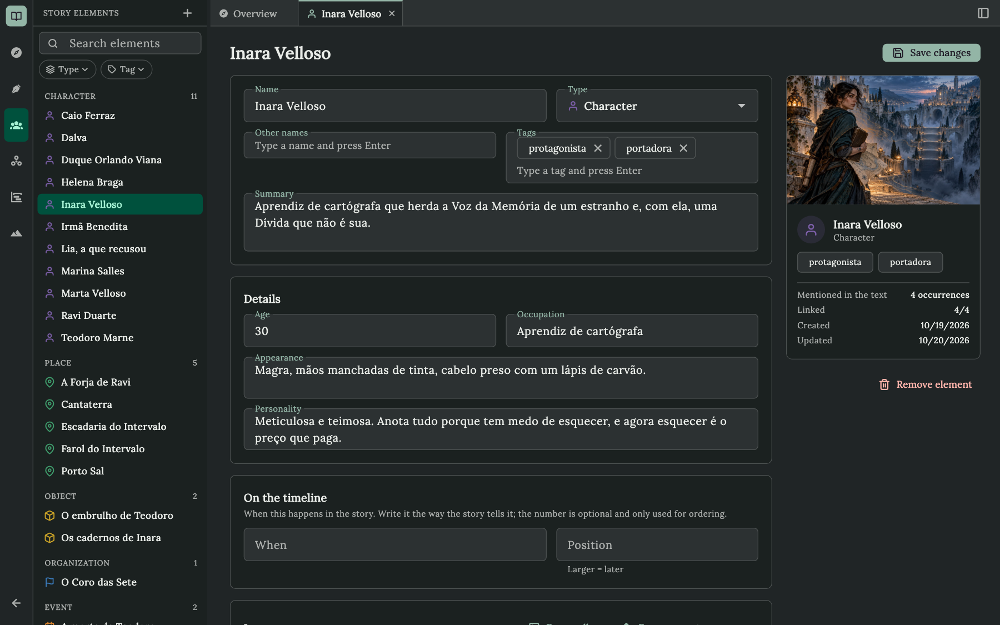
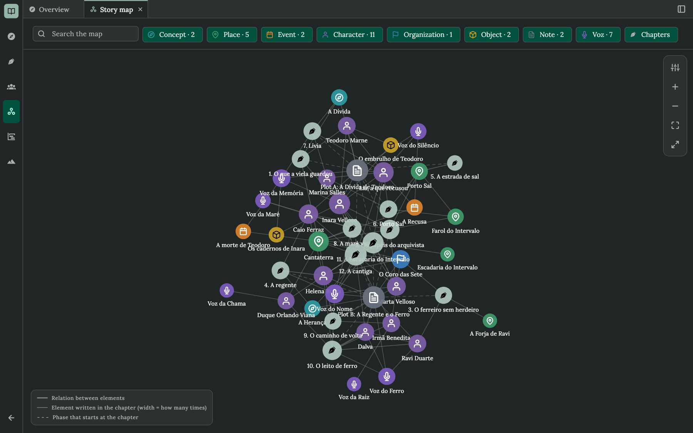
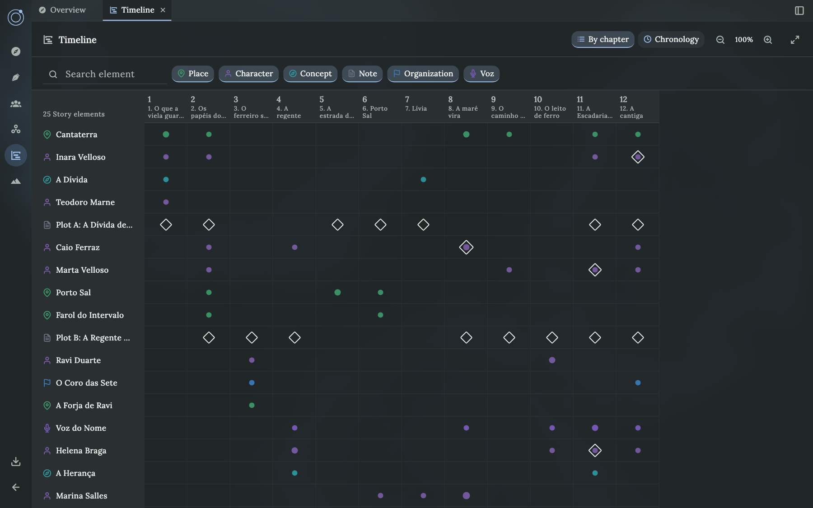
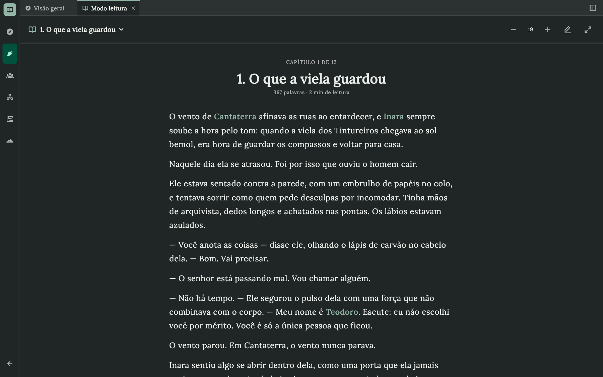
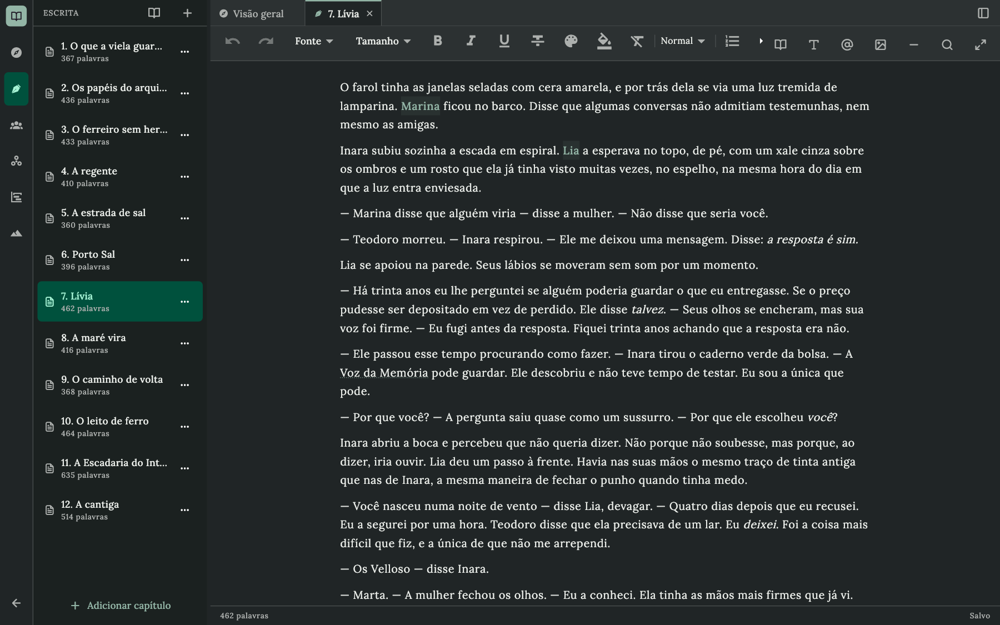
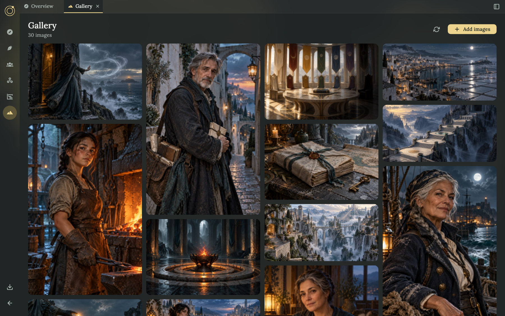
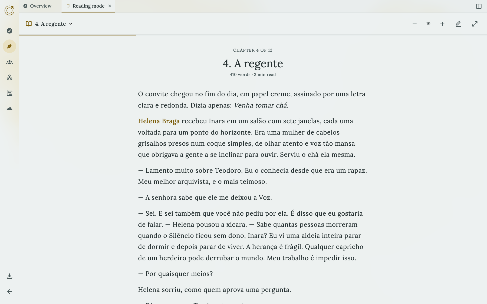
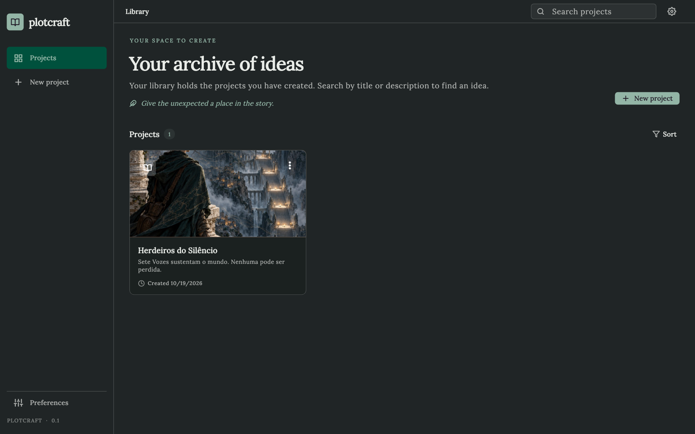

<div align="center">

**English** · [Português](README.pt-BR.md) · [Español](README.es.md)

# Plotcraft

**Architect your stories before and while you write.**

Characters, places, relationships and chapters in one place, kept in local files that belong to you.



</div>

Plotcraft is a desktop app for people who write stories of any genre and format. Each story is an organized project with context, metadata and tools to develop its elements while the text grows: what you write and what you plan stay connected.

> The app is at an early stage. The documentation describes the vision and the intended concepts, and not everything it mentions is finished.

## Features

<table>
  <tr>
    <td width="50%">
      
      <b>Story map.</b> A graph of elements, relations, chapters and where each element is cited, with type filters and focus on the selected element.
    </td>
    <td width="50%">
      
      <b>Timeline.</b> The story by chapter (who appears where and where each phase begins) and by the world's chronology, with free-form dates and an optional position.
    </td>
  </tr>
  <tr>
    <td width="50%">
      
      <b>Reading mode.</b> The book as a reader would see it: one chapter at a time, adjustable text and names that open their element with a click.
    </td>
    <td width="50%">
      
      <b>Writing.</b> A rich-text editor with fonts, colors, gallery images, the system spell checker (macOS) and mentions of your elements.
    </td>
  </tr>
  <tr>
    <td width="50%">
      
      <b>Gallery.</b> Visual references in a mosaic that respects each image's real proportion.
    </td>
    <td width="50%">
      
      <b>Your look.</b> Eight themes with light and dark variants, your own JSON themes, several interface fonts and fonts that travel with the project.
    </td>
  </tr>
</table>

### Projects and library

- **A library of stories.** Create, search, sort (most recent or by title), open and delete projects. When the library has more than one kind of story, you can filter by it.
- **Identity for each story.** Title, subtitle, author, genre, description, keywords and a cover: an image of your own or one of the generated covers.
- **Overview.** Words, chapters, elements and images of a project at a glance, and the project's details editable in place.
- **Any kind of story.** Free-form dates, optional structure and vocabulary that does not assume a genre. Books today; manga projects exist as a skeleton with elements and gallery.
- **Always in sync with the folder.** The library notices projects that another program adds, removes or renames in your projects folder.

### Writing

- **A single manuscript or chapters.** A book can keep one continuous text or be divided into chapters. Add, rename, reorder (by dragging) and remove chapters; removed chapters are archived, not erased. Word counts per chapter and for the whole book.
- **A rich-text editor.** Fonts and sizes, bold, italic, underline, strikethrough, text and highlight colors, headings, lists, quotes, indentation, alignment, dividers and images from your gallery.
- **Mentions that connect writing and planning.** Type `@` to link a name to an element, or let Plotcraft detect the names and aliases you already wrote; ignore the words that are only coincidences. Hover a name to see the element's card (cover, summary, details and the phase it is in at that chapter), and open it with Cmd/Ctrl + click.
- **Everyday tools.** Find and replace, undo and redo, autosave, full-screen mode, and a spell checker that uses the system's own (macOS).
- **Safe with other programs.** If a chapter changes outside the app, for example by an AI or a sync tool, Plotcraft updates it right away, or asks you which version to keep when you have unsaved edits.
- **Plain files.** Each chapter is saved as an editor document plus a readable Markdown copy.

### Reading mode

A chapter at a time in a comfortable column, with a progress bar for the whole book, text sizes from 14 to 30, ← → to change chapter, mentions that open their element, and the position and size remembered per project. It shows what you have not saved yet, and it works in full screen.

### Export your book

Save the book as an **EPUB** (it opens in Apple Books, Kobo and other e-readers, and Kindle accepts it through *Send to Kindle*), a **PDF** with cover, contents and page numbers, or a single **HTML** page. Choose the chapters, the cover, the table of contents and the language of the file. Use *Export book* in the Writing panel or in a project's menu; unsaved edits are included. An AI can do the same with the `export_book` tool.

### Story elements

- **Eight built-in types:** characters, places, objects, creatures, organizations, events, concepts and notes.
- **Your own types.** Create types such as *Spell* or *Faction* with their own icon, color and details: short and long text, numbers, dates, choices, yes/no, links, and references to other elements.
- **For each element:** icon and color, other names (aliases), tags, a summary, the details of its type, images (from the gallery or your computer; the first is the cover) and free-form sections in Markdown for backstory, rules, lore or research.
- **Phases.** Show how an element changes over the story: a phase can start at a chapter, carry changed details and have its own image. The element shown in a chapter uses the phase in force there.
- **Relations.** Link elements with labels that read both ways ("mentor of" / "student of"), plus a note.
- **Story time.** Say when something happens in the story's own words ("Year 312", "three days before"), with an optional number to put it in order.
- **Where it is used.** See every place an element is cited in the text and whether each mention is linked, and which other elements point to it in their details.

### Story map

An interactive graph of the whole story: elements, relations, chapters, where each element is cited (the line gets thicker with each mention) and where each phase begins. Filter by type, search, zoom, focus on one element and its connections, tune distance, repulsion, node size, names and link types in the display panel, and go full screen. The view you left is remembered.

### Timeline

- **By chapter:** a matrix of who appears in which chapter, with the phases that start there.
- **By chronology:** the world's events in order or to scale, with free-form dates. Drag a card to change its place, and zoom to open up a crowded stretch.
- Both appear once the project has elements, with filters, search, zoom, full screen and a remembered view.

### Gallery

Reference images in a mosaic where each one keeps its own proportion. Add images from your computer (or drop files into the project's `gallery` folder and refresh), view them large with next and previous, and use them as an element's cover, in a phase or inside the text. Every image has a stable ID, so links survive when you reorganize.

### Your look and your language

- **Eight themes**, each with light and dark variants: Violet, Paper, Midnight, Lavender, Moss, Rose, Ocean and Plum. Add your own as a JSON file.
- **Interface in English and Portuguese**, with more languages added by dropping in a translation file. The language of the interface does not limit the language of your story.
- **Fonts.** Choose the interface font (Times New Roman, DM Sans, Lora, Merriweather, Roboto) and add `.ttf`, `.otf` or `.ttc` fonts to a project so they travel with it and can be used in the text.
- **Your projects folder.** Keep your stories wherever you want; the library can gather projects from different places.

### Local files, yours to keep

Each project is a folder of readable files (Markdown for the text, JSON for the rest, ordinary image files). Copy it, back it up, put it under version control or open it with other tools. Nothing is locked into a database and nothing is sent anywhere.

### Works with AI

A built-in [MCP](https://modelcontextprotocol.io) server lets Claude Code, Claude Desktop and other clients create and edit the same projects the app opens, with more than 60 tools: projects, chapters, elements, types, phases, relations, the gallery, fonts and even the app's own theme and language. The AI reads before it writes, uses revisions so it never overwrites what you typed, asks for explicit confirmation before deleting anything and can run read-only. With the app open, you watch the changes appear while it works. See [How to use the MCP](#how-to-use-the-mcp).

## Try it with the sample story

Plotcraft ships a complete story, **Herdeiros do Silêncio** (in Portuguese), so you can explore without starting from scratch. On the home screen, choose **Explore the sample story**: it is copied to your projects folder and opens like any other project.

<div align="center">
  
</div>

Seven Voices hold the universe together, each with a single bearer, passed on by inheritance at a price. The story has 12 chapters, 25 interlinked elements, two plots and 30 images: enough to see the map, the timeline and the reading mode at work. Every screenshot in this README comes from it.

## Download

Ready-to-run builds for each desktop system are on the [Releases page](https://github.com/certainlyWrong/plotcraft/releases):

| System | File | How to run |
| --- | --- | --- |
| macOS (Apple Silicon and Intel) | `plotcraft-<version>-macos.dmg` | Open the disk image and drag **Plotcraft** to **Applications**. |
| Windows (64-bit) | `plotcraft-<version>-windows-x64.zip` | Unzip it and run `plotcraft.exe`. |
| Linux (64-bit) | `plotcraft-<version>-linux-x64.tar.gz` | Extract it and run `plotcraft/plotcraft`. It needs GTK 3 (`libgtk-3-0`). |

The [MCP server](#how-to-use-the-mcp) is published as well (`plotcraft-mcp-<version>-<system>`), so you do not need Dart to use it. `SHA256SUMS.txt` lists the checksums of every file.

The builds are not code-signed yet, so your system will warn you the first time:

- **macOS:** Control-click the app, choose **Open**, and confirm. If macOS says the app is damaged, run `xattr -dr com.apple.quarantine /Applications/Plotcraft.app` once.
- **Windows:** in the SmartScreen window, choose **More info → Run anyway**.

**For maintainers:** a release is built and published by [`.github/workflows/release.yml`](.github/workflows/release.yml) when a version tag is pushed (`git tag v1.0.0 && git push origin v1.0.0`). A tag with a dash, such as `v1.0.0-beta.1`, is published as a pre-release. The workflow can also be started by hand from the Actions tab to try the builds without publishing.

## Getting started

Requirements: [Flutter](https://docs.flutter.dev/get-started/install) (SDK ^3.13) with desktop support for your system. The system spell checker only exists on macOS; on Windows and Linux the editor works without it.

```sh
flutter pub get
flutter run -d macos        # or: -d windows, -d linux
```

Other useful commands:

```sh
flutter test                                   # the app's tests
(cd packages/plotcraft_core && dart test)      # tests of the core (pure Dart)
(cd packages/plotcraft_mcp && dart test)       # tests of the MCP server
flutter build macos --release                  # builds the app
dart run build_runner build --delete-conflicting-outputs   # after changing a MobX store
tool/screenshots/run.sh                        # screenshots of the screens in build/screenshots/
tool/screenshots/readme.sh                     # the README screenshots in docs/screenshots/ (from the sample story)
```

Projects are stored as files in the folder chosen in **Preferences → Projects folder** (by default, `Documents/Plotcraft`).

## How to use the MCP

The MCP server lets an AI (Claude Code, Claude Desktop and other clients) create and edit the same projects the app opens: chapters, elements, relations, phases, gallery and fonts. It does not need the app to be open; with the app open, the result shows on screen while the AI works, and the AI can also change the theme, open a chapter or use the spell checker.

**1. Build the executable** (needs Dart, which comes with Flutter):

```sh
tool/build_mcp.sh        # writes build/plotcraft-mcp
```

**2. Register it in your client**, pointing at the same projects folder the app uses:

```sh
# Claude Code
claude mcp add plotcraft -- "$PWD/build/plotcraft-mcp" --root ~/Documents/Plotcraft
```

Claude Desktop (`claude_desktop_config.json`):

```json
{
  "mcpServers": {
    "plotcraft": {
      "command": "/path/to/build/plotcraft-mcp",
      "args": ["--root", "/Users/you/Documents/Plotcraft"]
    }
  }
}
```

Options: `--root <folder>` (or the `PLOTCRAFT_ROOT` variable), `--project <folder>` for a project folder outside the root and `--read-only` to prevent any change.

**3. Ask in plain language**, for example: *"Create a mystery novel called The Salt Road, with three characters and a first chapter."* The AI reads before it writes, uses revisions to never overwrite what you typed, and asks for explicit confirmation before deleting anything. If both of you edit the same chapter, the app asks which version to keep.

The full tool catalog, the errors and the examples are in [`packages/plotcraft_mcp/README.md`](packages/plotcraft_mcp/README.md); the design and the security model are in [MCP](docs/mcp.md).

## Documentation

- [Product vision](docs/product-vision.md) — purpose, audience and the intended experience.
- [Project model](docs/project-model.md) — what makes up a story project, and its files.
- [Experience and preferences](docs/experience-and-preferences.md) — desktop focus, themes and languages.
- [Application architecture](docs/architecture.md) — how the code is organized, packages and the sample project.
- [Website](website/README.md) — the Vue site that presents Plotcraft and offers the downloads.
- [MCP](docs/mcp.md) — how an AI creates and manages stories through Plotcraft (server in [`packages/plotcraft_mcp`](packages/plotcraft_mcp/README.md)).

The documentation is written in English, with translations in [Português](docs/pt-BR/README.md) and [Español](docs/es/README.md).
